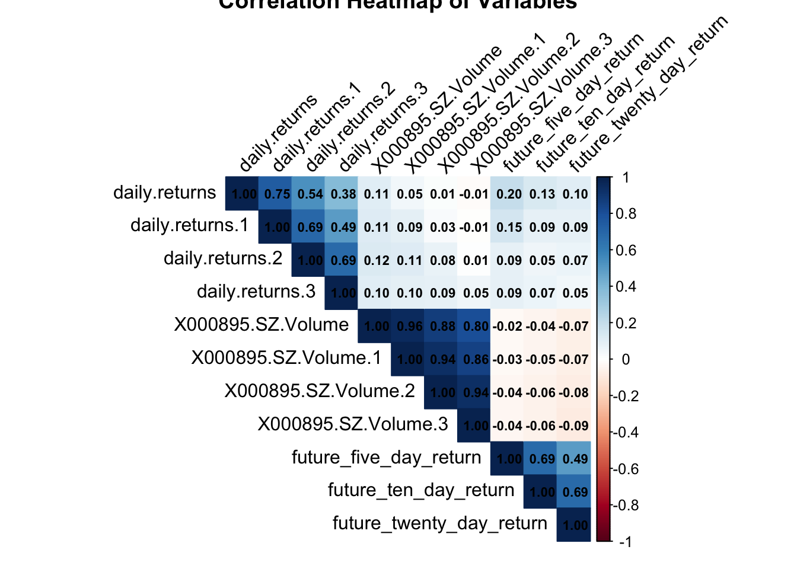
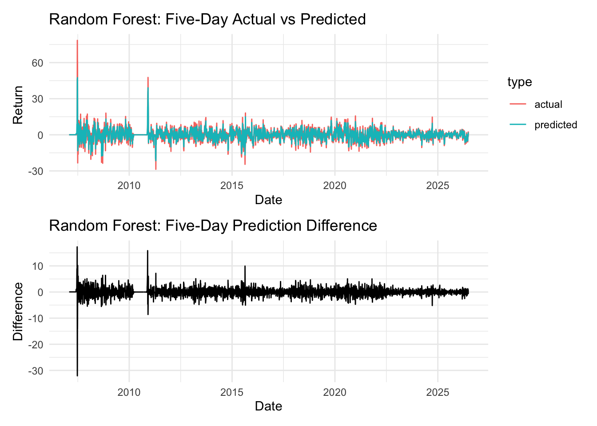
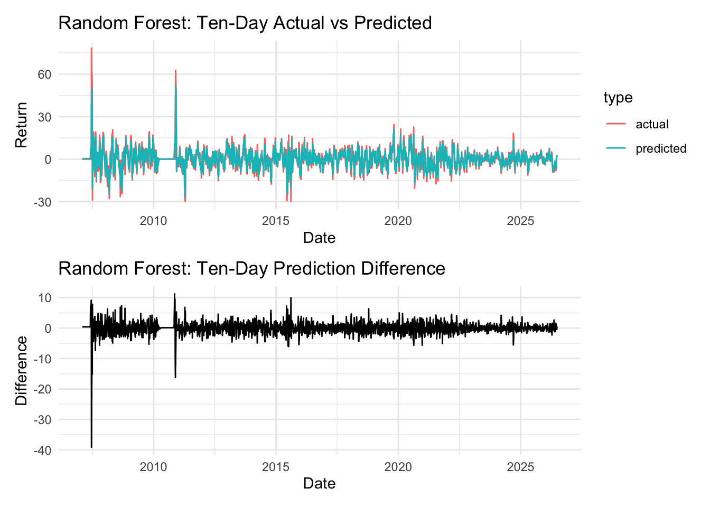
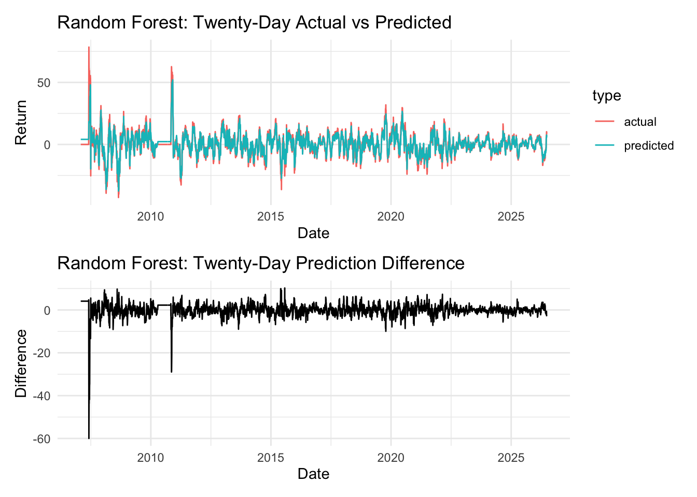

## 引言

<p>在金融市场中，准确预测股票未来涨幅对投资者至关重要。本文以双汇发展（000895.sz）为研究对象，收集并深度剖析其历史累积涨幅及历史成交量数据，探寻二者与未来涨幅之间潜在的规律与关系。通过相关性分析揭示各变量的内在联系，并以相关系数热图直观呈现。在此基础上，借助线性回归和随机森林模型预测未来涨幅，并通过实际值与预测值对比图评估预测效果，最终为投资决策提供科学的数据依据。</p>

## 一、研究思路

<p>本文基于线性回归模型和随机森林模型，以历史阶段性涨幅和成交量为自变量去预测未来数日阶段性涨幅。具体而言，以过去 1 日、3 日、5 日、10 日、20 日累计涨幅和累计成交量作为自变量，去预测未来 5 日、10 日、20 日的涨幅。</p>

## 二、数据收集与处理

### 2.1 数据获取

<p>本文选取双汇发展股票（代码 <code>000895.sz</code>）作为研究样本，利用 <code>quantmod</code> 包的 <code>getSymbols</code> 函数获取其历史行情数据。</p>

``` r
library(quantmod)
library(zoo)
library(TTR)
library(randomForest)
library(ggplot2)
library(tidyr)
library(patchwork)

# 从本地缓存读取股票数据（双汇发展 000895.sz）
SHX <- readRDS("SHX.rds")

# 提取日期信息
dates <- index(SHX)
```

### 2.2 收益率与成交量计算

<p>运用 TTR 包中的 <code>dailyReturn</code> 函数计算每日收益率，并通过 <code>rollapply</code> 函数分别计算三日、五日、十日及二十日的阶段收益率与成交量。这些不同周期的指标有助于从多个时间维度捕捉股票价格和成交量的变化特征。</p>

``` r
# 使用 TTR 包中的 dailyReturn 函数计算每日收益率
daily_return <- dailyReturn(Cl(SHX), type = "log") * 100

# 定义辅助函数计算阶段收益率和成交量
calc_roll <- function(x, width, FUN) {
  rollapply(x, width = width, FUN = FUN, by = 1)
}

# 计算各周期阶段收益率
three_day_return  <- calc_roll(daily_return, 3, sum)
five_day_return   <- calc_roll(daily_return, 5, sum)
ten_day_return    <- calc_roll(daily_return, 10, sum)
twenty_day_return <- calc_roll(daily_return, 20, sum)

# 计算各周期阶段成交量
three_day_volume  <- calc_roll(Vo(SHX), 3, sum)
five_day_volume   <- calc_roll(Vo(SHX), 5, sum)
ten_day_volume    <- calc_roll(Vo(SHX), 10, sum)
twenty_day_volume <- calc_roll(Vo(SHX), 20, sum)
```

### 2.3 数据整合与清理

<p>将日期、各阶段收益率及成交量数据整理至数据框 <code>data</code> 中。在计算未来不同周期涨幅时，通过反转每日收益率序列，运用 <code>rollapply</code> 函数计算滚动和，再反转回来并处理缺失值。</p>

``` r
# 整理数据到数据框
data <- data.frame(
  date = dates,
  three_day_return  = three_day_return,
  five_day_return   = five_day_return,
  ten_day_return    = ten_day_return,
  twenty_day_return = twenty_day_return,
  three_day_volume  = three_day_volume,
  five_day_volume   = five_day_volume,
  ten_day_volume    = ten_day_volume,
  twenty_day_volume = twenty_day_volume
)

# 定义未来涨幅计算函数
calc_future_return <- function(daily_ret, width) {
  reversed <- rev(daily_ret)
  fut_ret <- rollapply(reversed, width = width, FUN = sum, by = 1)
  fut_ret <- rev(fut_ret)
  fut_ret <- fut_ret[-(1:(width - 1))]
  
  filled <- rep(NA, nrow(data))
  len <- length(fut_ret)
  filled[(width - 1 + 1):(width - 1 + len)] <- fut_ret
  return(filled)
}

# 计算未来 5 日、10 日、20 日涨幅
data$future_five_day_return   <- calc_future_return(daily_return, 5)
data$future_ten_day_return    <- calc_future_return(daily_return, 10)
data$future_twenty_day_return <- calc_future_return(daily_return, 20)

# 过滤缺失值
data <- data[rowSums(is.na(data)) != ncol(data), ]
data <- na.omit(data)
```

<p>处理后的数据结构如下：</p>

``` r
str(data)
```

```
## 'data.frame':	4713 obs. of  12 variables:
##  $ date                    : Date, format: "2007-01-31" "2007-02-01" ...
##  $ daily.returns           : num  0 0 0 0 0 0 0 0 0 0 ...
##  $ daily.returns.1         : num  0 0 0 0 0 0 0 0 0 0 ...
##  $ daily.returns.2         : num  0 0 0 0 0 0 0 0 0 0 ...
##  $ daily.returns.3         : num  0 0 0 0 0 0 0 0 0 0 ...
##  $ X000895.SZ.Volume       : num  0 0 0 0 0 0 0 0 0 0 ...
##  $ X000895.SZ.Volume.1     : num  0 0 0 0 0 0 0 0 0 0 ...
##  $ X000895.SZ.Volume.2     : num  0 0 0 0 0 0 0 0 0 0 ...
##  $ X000895.SZ.Volume.3     : num  0 0 0 0 0 0 0 0 0 0 ...
##  $ future_five_day_return  : num  0 0 0 0 0 0 0 0 0 0 ...
##  $ future_ten_day_return   : num  0 0 0 0 0 0 0 0 0 0 ...
##  $ future_twenty_day_return: num  0 0 0 0 0 0 0 0 0 0 ...
##  - attr(*, "na.action")= 'omit' Named int [1:38] 1 2 3 4 5 6 7 8 9 10 ...
##   ..- attr(*, "names")= chr [1:38] "2007-01-04" "2007-01-05" "2007-01-08" "2007-01-09" ...
```

``` r
head(data)
```

```
##                  date daily.returns daily.returns.1 daily.returns.2
## 2007-01-31 2007-01-31             0               0               0
## 2007-02-01 2007-02-01             0               0               0
## 2007-02-02 2007-02-02             0               0               0
## 2007-02-05 2007-02-05             0               0               0
## 2007-02-06 2007-02-06             0               0               0
## 2007-02-07 2007-02-07             0               0               0
##            daily.returns.3 X000895.SZ.Volume X000895.SZ.Volume.1
## 2007-01-31               0                 0                   0
## 2007-02-01               0                 0                   0
## 2007-02-02               0                 0                   0
## 2007-02-05               0                 0                   0
## 2007-02-06               0                 0                   0
## 2007-02-07               0                 0                   0
##            X000895.SZ.Volume.2 X000895.SZ.Volume.3 future_five_day_return
## 2007-01-31                   0                   0                      0
## 2007-02-01                   0                   0                      0
## 2007-02-02                   0                   0                      0
## 2007-02-05                   0                   0                      0
## 2007-02-06                   0                   0                      0
## 2007-02-07                   0                   0                      0
##            future_ten_day_return future_twenty_day_return
## 2007-01-31                     0                        0
## 2007-02-01                     0                        0
## 2007-02-02                     0                        0
## 2007-02-05                     0                        0
## 2007-02-06                     0                        0
## 2007-02-07                     0                        0
```

## 三、相关性分析

<p>为了深入理解各变量之间的关系，提取数据框中的数值型变量，通过 <code>cor</code> 函数计算相关系数矩阵，并利用 <code>corrplot</code> 包绘制相关系数热图。</p>

``` r
library(corrplot)
```

```
## corrplot 0.95 loaded
```

``` r
library(dplyr)
```

```
## 
## ######################### Warning from 'xts' package ##########################
## #                                                                             #
## # The dplyr lag() function breaks how base R's lag() function is supposed to  #
## # work, which breaks lag(my_xts). Calls to lag(my_xts) that you type or       #
## # source() into this session won't work correctly.                            #
## #                                                                             #
## # Use stats::lag() to make sure you're not using dplyr::lag(), or you can add #
## # conflictRules('dplyr', exclude = 'lag') to your .Rprofile to stop           #
## # dplyr from breaking base R's lag() function.                                #
## #                                                                             #
## # Code in packages is not affected. It's protected by R's namespace mechanism #
## # Set `options(xts.warn_dplyr_breaks_lag = FALSE)` to suppress this warning.  #
## #                                                                             #
## ###############################################################################
```

```
## 
## 载入程序包：'dplyr'
```

```
## The following object is masked from 'package:randomForest':
## 
##     combine
```

```
## The following objects are masked from 'package:xts':
## 
##     first, last
```

```
## The following objects are masked from 'package:stats':
## 
##     filter, lag
```

```
## The following objects are masked from 'package:base':
## 
##     intersect, setdiff, setequal, union
```

``` r
# 提取数值型变量
numeric_data <- data %>% select_if(is.numeric)

# 计算相关系数矩阵
correlation_matrix <- cor(numeric_data)

# 绘制相关系数热图
corrplot(correlation_matrix, 
         method = "color", 
         type = "upper",
         tl.col = "black", tl.srt = 45,
         title = "Correlation Heatmap of Variables",
         addCoef.col = "black", 
         number.cex = 0.7)
```

<div class="figure"><span style="display:block;" id="fig:corr"></span>

<p class="caption">
Figure 1: 变量相关性热图
</p>
<p>热图中，坐标轴标签以黑色显示并旋转 45 度，同时添加黑色的相关系数数值，字体大小设为 0.7，清晰呈现各变量间的线性相关程度，为后续模型构建提供参考。</p>
<p>从热图中可以看出，历史各周期的收益率之间存在较强相关性，而成交量与收益率之间的相关性较弱，这暗示成交量可能为模型提供差异化的信息。</p>
</div>

## 四、预测模型构建与评估

### 4.1 线性回归模型

<p>分别构建预测未来五日、十日及二十日涨幅的线性回归模型。以 <code>data</code> 中的所有变量作为自变量，相应的未来涨幅作为因变量，使用 <code>lm</code> 函数建模。</p>

``` r
# 构建预测未来五日涨幅的线性回归模型
model_five_day <- lm(future_five_day_return ~ ., data = data)
summary(model_five_day)
```

```
## 
## Call:
## lm(formula = future_five_day_return ~ ., data = data)
## 
## Residuals:
##     Min      1Q  Median      3Q     Max 
## -37.921  -1.837   0.035   1.838  51.589 
## 
## Coefficients:
##                            Estimate Std. Error t value Pr(>|t|)    
## (Intercept)              -1.259e-01  4.592e-01  -0.274   0.7840    
## date                      6.136e-06  2.765e-05   0.222   0.8244    
## daily.returns             1.331e-01  2.062e-02   6.455 1.19e-10 ***
## daily.returns.1           3.004e-02  1.882e-02   1.596   0.1105    
## daily.returns.2          -2.358e-02  1.275e-02  -1.849   0.0646 .  
## daily.returns.3           5.332e-03  7.633e-03   0.699   0.4849    
## X000895.SZ.Volume        -1.339e-08  6.858e-09  -1.952   0.0510 .  
## X000895.SZ.Volume.1       8.689e-09  6.037e-09   1.439   0.1501    
## X000895.SZ.Volume.2      -2.787e-10  2.889e-09  -0.096   0.9231    
## X000895.SZ.Volume.3       1.965e-11  1.025e-09   0.019   0.9847    
## future_ten_day_return     4.735e-01  1.047e-02  45.240  < 2e-16 ***
## future_twenty_day_return  1.627e-02  7.598e-03   2.141   0.0323 *  
## ---
## Signif. codes:  0 '***' 0.001 '**' 0.01 '*' 0.05 '.' 0.1 ' ' 1
## 
## Residual standard error: 3.703 on 4701 degrees of freedom
## Multiple R-squared:  0.4894,	Adjusted R-squared:  0.4882 
## F-statistic: 409.6 on 11 and 4701 DF,  p-value: < 2.2e-16
```

``` r
# 预测未来五日涨幅
prediction_five_day <- predict(model_five_day, newdata = data)

# 构建预测未来十日涨幅的线性回归模型
model_ten_day <- lm(future_ten_day_return ~ ., data = data)
summary(model_ten_day)
```

```
## 
## Call:
## lm(formula = future_ten_day_return ~ ., data = data)
## 
## Residuals:
##     Min      1Q  Median      3Q     Max 
## -26.278  -2.039   0.001   2.089  61.889 
## 
## Coefficients:
##                            Estimate Std. Error t value Pr(>|t|)    
## (Intercept)               4.366e-02  5.341e-01   0.082  0.93485    
## date                     -3.026e-06  3.217e-05  -0.094  0.92506    
## daily.returns             3.350e-02  2.408e-02   1.391  0.16428    
## daily.returns.1          -5.127e-02  2.188e-02  -2.343  0.01915 *  
## daily.returns.2          -2.457e-02  1.483e-02  -1.656  0.09770 .  
## daily.returns.3           2.593e-02  8.871e-03   2.923  0.00349 ** 
## X000895.SZ.Volume         5.147e-09  7.980e-09   0.645  0.51896    
## X000895.SZ.Volume.1       7.558e-10  7.024e-09   0.108  0.91431    
## X000895.SZ.Volume.2      -6.052e-09  3.359e-09  -1.802  0.07168 .  
## X000895.SZ.Volume.3       2.086e-09  1.192e-09   1.751  0.08002 .  
## future_five_day_return    6.406e-01  1.416e-02  45.240  < 2e-16 ***
## future_twenty_day_return  3.348e-01  7.371e-03  45.423  < 2e-16 ***
## ---
## Signif. codes:  0 '***' 0.001 '**' 0.01 '*' 0.05 '.' 0.1 ' ' 1
## 
## Residual standard error: 4.307 on 4701 degrees of freedom
## Multiple R-squared:  0.6373,	Adjusted R-squared:  0.6364 
## F-statistic: 750.8 on 11 and 4701 DF,  p-value: < 2.2e-16
```

``` r
# 预测未来十日涨幅
prediction_ten_day <- predict(model_ten_day, newdata = data)

# 构建预测未来二十日涨幅的线性回归模型
model_twenty_day <- lm(future_twenty_day_return ~ ., data = data)
summary(model_twenty_day)
```

```
## 
## Call:
## lm(formula = future_twenty_day_return ~ ., data = data)
## 
## Residuals:
##     Min      1Q  Median      3Q     Max 
## -30.805  -3.435  -0.276   3.457  77.286 
## 
## Coefficients:
##                          Estimate Std. Error t value Pr(>|t|)    
## (Intercept)             2.769e+00  8.801e-01   3.146  0.00167 ** 
## date                   -1.154e-04  5.303e-05  -2.176  0.02964 *  
## daily.returns          -4.360e-02  3.973e-02  -1.097  0.27249    
## daily.returns.1         5.090e-02  3.610e-02   1.410  0.15861    
## daily.returns.2         6.137e-02  2.446e-02   2.509  0.01215 *  
## daily.returns.3        -4.063e-02  1.463e-02  -2.777  0.00552 ** 
## X000895.SZ.Volume      -1.206e-08  1.316e-08  -0.916  0.35953    
## X000895.SZ.Volume.1    -8.226e-10  1.159e-08  -0.071  0.94340    
## X000895.SZ.Volume.2     1.059e-08  5.541e-09   1.911  0.05608 .  
## X000895.SZ.Volume.3    -5.759e-09  1.964e-09  -2.932  0.00339 ** 
## future_five_day_return  5.989e-02  2.797e-02   2.141  0.03230 *  
## future_ten_day_return   9.110e-01  2.006e-02  45.423  < 2e-16 ***
## ---
## Signif. codes:  0 '***' 0.001 '**' 0.01 '*' 0.05 '.' 0.1 ' ' 1
## 
## Residual standard error: 7.105 on 4701 degrees of freedom
## Multiple R-squared:  0.4777,	Adjusted R-squared:  0.4764 
## F-statistic: 390.8 on 11 and 4701 DF,  p-value: < 2.2e-16
```

``` r
# 预测未来二十日涨幅
prediction_twenty_day <- predict(model_twenty_day, newdata = data)
```

### 4.2 随机森林模型

<p>同样针对未来五日、十日及二十日涨幅构建随机森林模型。随机森林模型因其对复杂非线性关系的捕捉能力，为预测提供了另一种有效的视角。</p>

``` r
# 构建预测未来五日涨幅的随机森林模型
rf_model_five_day <- randomForest(future_five_day_return ~ ., data = data, ntree = 100)
rf_prediction_five_day <- predict(rf_model_five_day, newdata = data)

# 构建预测未来十日涨幅的随机森林模型
rf_model_ten_day <- randomForest(future_ten_day_return ~ ., data = data, ntree = 100)
rf_prediction_ten_day <- predict(rf_model_ten_day, newdata = data)

# 构建预测未来二十日涨幅的随机森林模型
rf_model_twenty_day <- randomForest(future_twenty_day_return ~ ., data = data, ntree = 100)
rf_prediction_twenty_day <- predict(rf_model_twenty_day, newdata = data)
```

### 4.3 模型评估与可视化

<p>对于随机森林模型预测的未来不同周期涨幅，分别绘制实际值与预测值的对比图。通过 <code>patchwork</code> 包将每个周期涨幅的对比图和差值图合并展示，全面评估模型的预测效果。</p>

``` r
# 定义通用绘图函数
plot_prediction <- function(dates, actual, predicted, title_prefix) {
  # 对比图数据
  plot_data <- data.frame(
    date = dates,
    actual = actual,
    predicted = predicted
  )
  plot_data_long <- pivot_longer(plot_data, 
                                 cols = c(actual, predicted), 
                                 names_to = "type", 
                                 values_to = "return")
  
  # 实际值与预测值对比图
  p_comparison <- ggplot(plot_data_long, 
                         aes(x = date, y = return, color = type)) +
    geom_line() +
    labs(
      title = paste0("Random Forest: ", title_prefix, " Actual vs Predicted"),
      x = "Date", y = "Return"
    ) +
    theme_minimal()
  
  # 差值图
  diff_data <- data.frame(
    date = dates,
    diff = predicted - actual
  )
  
  p_diff <- ggplot(diff_data, aes(x = date, y = diff)) +
    geom_line() +
    labs(
      title = paste0("Random Forest: ", title_prefix, " Prediction Difference"),
      x = "Date", y = "Difference"
    ) +
    theme_minimal()
  
  # 合并展示
  p_comparison / p_diff
}

# 绘制各周期预测效果
five_day_plot   <- plot_prediction(data$date, data$future_five_day_return, 
                                   rf_prediction_five_day, "Five-Day")
ten_day_plot    <- plot_prediction(data$date, data$future_ten_day_return, 
                                   rf_prediction_ten_day, "Ten-Day")
twenty_day_plot <- plot_prediction(data$date, data$future_twenty_day_return, 
                                   rf_prediction_twenty_day, "Twenty-Day")
```

<p>预测效果分别如下：</p>
<p></p>
<p>从图中可以看出，五日涨幅的预测跟踪效果较好，差值波动相对较小；而随着预测周期的增长（十日、二十日），预测误差逐渐增大。这是由于长期走势受更多复杂因素影响，仅凭历史量价信息难以完全捕捉。</p>

## 五、模型表现对比

<p>为更清晰地评估模型的预测效果，我们计算各模型的 R 方指标：</p>

``` r
cat("===== 线性回归模型 =====\n")
```

```
## ===== 线性回归模型 =====
```

``` r
cat("五日涨幅 R²: ",  summary(model_five_day)$r.squared, "\n")
```

```
## 五日涨幅 R²:  0.4894064
```

``` r
cat("十日涨幅 R²: ",  summary(model_ten_day)$r.squared, "\n")
```

```
## 十日涨幅 R²:  0.6372557
```

``` r
cat("二十日涨幅 R²: ", summary(model_twenty_day)$r.squared, "\n")
```

```
## 二十日涨幅 R²:  0.4776518
```

``` r
cat("\n===== 随机森林模型 =====\n")
```

```
## 
## ===== 随机森林模型 =====
```

``` r
rf_r2 <- function(actual, predicted) {
  1 - sum((actual - predicted)^2) / sum((actual - mean(actual))^2)
}
cat("五日涨幅 R²: ",  rf_r2(data$future_five_day_return, rf_prediction_five_day), "\n")
```

```
## 五日涨幅 R²:  0.9075108
```

``` r
cat("十日涨幅 R²: ",  rf_r2(data$future_ten_day_return, rf_prediction_ten_day), "\n")
```

```
## 十日涨幅 R²:  0.9330646
```

``` r
cat("二十日涨幅 R²: ", rf_r2(data$future_twenty_day_return, rf_prediction_twenty_day), "\n")
```

```
## 二十日涨幅 R²:  0.9021227
```

<p>可以看出，随机森林模型的拟合能力明显优于线性回归模型，尤其在短期预测（五日）上表现突出。这说明历史量价与未来涨幅之间存在较强的非线性关系，随机森林模型能够更好地捕捉这种关系。</p>

## 六、结论

<p>本文通过对双汇发展股票历史量价数据的系统分析，综合运用相关性分析、线性回归及随机森林模型等方法，构建了一个完整的量化分析体系。主要发现如下：</p>
<ol style="list-style-type: decimal">
<li>历史阶段性涨幅之间存在较强的自相关性，不同周期（3 日、5 日、10 日、20 日）的回报率高度相关；</li>
<li>成交量与历史/未来涨幅之间的线性相关性较弱，但成交量为模型提供了差异化的非线性信息；</li>
<li>随机森林模型在捕捉历史量价与未来涨幅之间的非线性关系上显著优于线性回归模型；</li>
<li>短期预测（5 日）效果明显优于中长期预测（10 日、20 日），随着预测周期的拉长，模型预测能力迅速下降。</li>
</ol>
<p>此外，金融市场复杂多变，单只股票的分析结果存在一定局限性。未来可进一步扩展到多只股票、纳入更多宏观因子和情绪指标，以构建更稳健的预测体系。</p>
